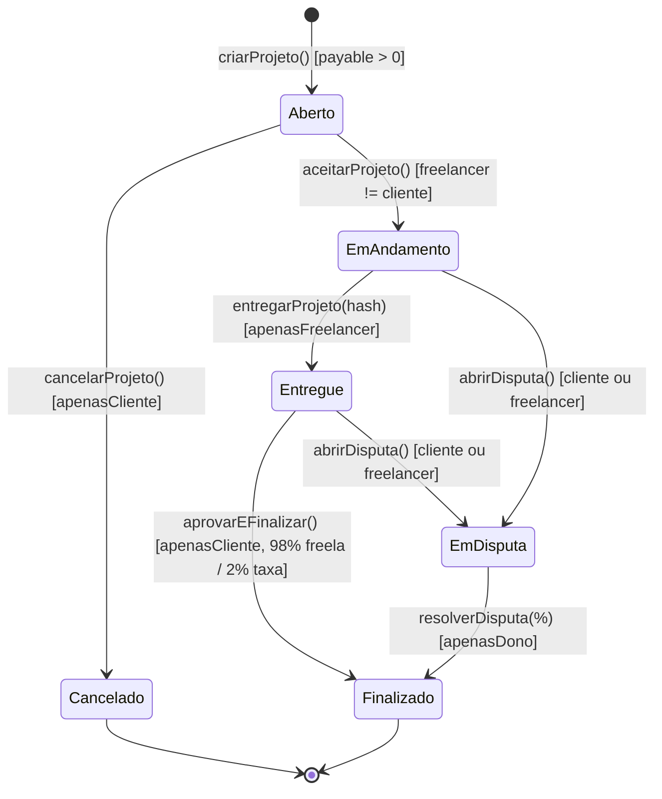

# 💼 Smart Freela — dApp de Escrow Descentralizado na Ethereum Sepolia

> Trabalho Prático da disciplina de **Oficina de Desenvolvimento de Sistemas 3** (Blockchain, Smart Contracts e dApps) — Curso de Sistemas de Informação (UEA-EST)  
> Docente: Prof. Fábio

---

## 1. Nome da dApp, Tema e Problema Resolvido

* **Nome da dApp:** **Smart Freela**
* **Tema:** Custódia Financeira (*Escrow*) Descentralizada para Contratação de Serviços Freelance
* **Problema Resolvido:**
  Plataformas tradicionais centralizadas de contratação freelance cobram taxas elevadas (frequentemente entre 10% e 20%), impõem prazos longos de liberação financeira e operam sistemas de mediação unilaterais. Por outro lado, acordos diretos sem intermediação expõem contratantes ao risco de não entrega e profissionais autônomos ao risco de inadimplência (*calote*).

O **Smart Freela** resolve esse problema utilizando a rede **Ethereum Sepolia** para automatizar a custódia e a liquidação dos pagamentos:
1. **Garantia Matemática de Fundos (Escrow):** O cliente cria a demanda depositando o valor em ETH diretamente no contrato inteligente (`criarProjeto`), onde o saldo fica retido até a conclusão ou resolução.
2. **Execução Segura para o Freelancer:** O freelancer aceita o serviço (`aceitarProjeto`) sabendo previamente que os fundos estão bloqueados on-chain.
3. **Entrega Criptograficamente Auditável:** Ao concluir o serviço, o freelancer registra on-chain o hash `bytes32` (Keccak-256) do entregável (`entregarProjeto`), garantindo prova imutável de entrega sem onerar o armazenamento da blockchain.
4. **Liquidação Automatizada com Taxa Mínima:** Ao aprovar (`aprovarEFinalizar`), o contrato transfere **98%** do valor ao freelancer e retém **2%** como taxa de manutenção da plataforma.
5. **Cancelamento e Mediação de Disputas:** Projetos ainda abertos podem ser cancelados pelo cliente com reembolso de 100% (`cancelarProjeto`). Projetos em andamento ou entregues permitem abertura de disputa (`abrirDisputa`), mediada pelo administrador do contrato (`resolverDisputa`) com divisão percentual configurável entre as partes.



---

## 2. Integrantes e Papel de Cada Um

| Integrante | RA | Papel na Equipe |
|---|---|---|
| **João Castro** | 2315310009 | Contrato Inteligente, Frontend & Deploy na Vercel |
| **Pedro Yutaro** | 2315310020 | Modelagem SDD, Remix IDE & Deploy na Sepolia |
| **Lucas Carvalho** | 2315310012 | Documentação |
| **Renato Barbosa** | 2315310021 | Vídeo de Demonstração |

---

## 3. Dados do Deploy na Sepolia, URL da Vercel e Vídeo

* **Contrato Inteligente:** `SmartFreela` ([contracts/smart-freela.sol](contracts/smart-freela.sol))
* **Rede:** Ethereum Sepolia Testnet (`Chain ID: 11155111` / `0xaa36a7`)
* **Endereço do Contrato:** `0xaAe2fb64bB43e03e1C1563c59588EbF62EeD2640`
* **Carteira Criadora (`dono` / Contract Creator):** `0xf834Bc7C9272b1f6Cdd31Fb52E782Ad1447DFC24`
* **Hash da Transação de Deploy:** [`0x15b1d3a7caa6fa810db81bf14b1b380a27cb9c1b897629ed167bdce0057e4804`](https://sepolia.etherscan.io/tx/0x15b1d3a7caa6fa810db81bf14b1b380a27cb9c1b897629ed167bdce0057e4804)
* **Número do Bloco do Deploy:** [`12138111`](https://sepolia.etherscan.io/block/12138111)
* **Status no Sepolia Etherscan:** Implantado e ativo; verificação do código-fonte pendente (`Verify and Publish` na aba `Contract` do Etherscan)
* **Link no Sepolia Etherscan:** [https://sepolia.etherscan.io/address/0xaAe2fb64bB43e03e1C1563c59588EbF62EeD2640](https://sepolia.etherscan.io/address/0xaAe2fb64bB43e03e1C1563c59588EbF62EeD2640)
* **URL da dApp na Vercel:** [https://smart-freela-test-zcep.vercel.app/frontend/](https://smart-freela-test-zcep.vercel.app/frontend/)
* **Repositório GitHub:** [https://github.com/JlCastr0/smart-freela](https://github.com/JlCastr0/smart-freela)
* **Vídeo de Demonstração (3 a 5 min):** [https://youtu.be/IgtKXCJj7ag](https://youtu.be/IgtKXCJj7ag)

---

## 4. Descrição das Funções do Contrato (`SmartFreela.sol`)

Além dos *getters* automáticos de variáveis públicas (`dono`, `TAXA_PLATAFORMA_PERCENTUAL`, `totalProjetos`, `taxasAcumuladas`, `reputacaoInicialPadrao`, `ativo`, `projetos`, `projetosParticipados`), o contrato implementa **11 funções externas/públicas**, **1 construtor** e **2 funções auxiliares (`internal` e `private`)**:

| Função / Assinatura | Visibilidade / Mutabilidade | Quem pode chamar | O que faz | Eventos emitidos | Erros possíveis |
|---|---|---|---|---|---|
| `constructor()` | `constructor` | Conta que realiza o deploy | Define `dono = msg.sender` (`immutable`). | — | — |
| `criarProjeto(string titulo, string descricao)` | `external payable` | Qualquer conta (Cliente) | Valida valor e textos, incrementa `totalProjetos`, registra `Projeto` com status `Aberto`, indexa em `_todosOsIds` e `projetosParticipados`, retendo o ETH em custódia. | `ProjetoCriado(id, cliente, valor)` | `ValorInvalido`, `DadosInvalidos` |
| `obterProjeto(uint256 id)` | `external view` | Qualquer conta / Frontend | Retorna a `struct Projeto` completa para o `id` informado. | — | `ProjetoInexistente` |
| `aceitarProjeto(uint256 id)` | `external` | Qualquer conta exceto o cliente do projeto | Valida `noStatus(id, Aberto)`, vincula `msg.sender` como `freelancer`, marca `projetosParticipados` e muda status para `EmAndamento`. | `ProjetoAceito(id, freelancer)` | `ProjetoInexistente`, `StatusIncorreto`, `AcessoNegado` |
| `entregarProjeto(uint256 id, bytes32 hashEntrega)` | `external` | Apenas o `freelancer` do projeto | Valida `noStatus(id, EmAndamento)` e `apenasFreelancer(id)`, garante hash não-nulo, grava `hashEntrega` e muda status para `Entregue`. | `ProjetoEntregue(id, hashEntrega)` | `ProjetoInexistente`, `StatusIncorreto`, `AcessoNegado`, `DadosInvalidos` |
| `aprovarEFinalizar(uint256 id)` | `external` | Apenas o `cliente` do projeto | Valida `noStatus(id, Entregue)` e `apenasCliente(id)`. Atualiza status para `Finalizado` e `finalizadoEm`, calcula taxa (2%) e acumula em `taxasAcumuladas` antes de transferir 98% ao freelancer (padrão *Checks-Effects-Interactions*). | `ProjetoFinalizado(id, freelancer, valorLiquido)` | `ProjetoInexistente`, `StatusIncorreto`, `AcessoNegado`, `FalhaNoPagamento` |
| `cancelarProjeto(uint256 id)` | `external` | Apenas o `cliente` do projeto | Valida `noStatus(id, Aberto)` e `apenasCliente(id)`, altera status para `Cancelado` e devolve 100% do depósito ao cliente. | `ProjetoCancelado(id, cliente)` | `ProjetoInexistente`, `StatusIncorreto`, `AcessoNegado`, `FalhaNoPagamento` |
| `abrirDisputa(uint256 id)` | `external` | `cliente` ou `freelancer` do projeto | Exige projeto existente, que o chamador seja parte envolvida e que o status seja `EmAndamento` ou `Entregue`; muda status para `EmDisputa`. | `DisputaAberta(id, solicitante)` | `ProjetoInexistente`, `AcessoNegado`, `StatusIncorreto` |
| `resolverDisputa(uint256 id, uint256 percentualFreelancer)` | `external` | Apenas o `dono` (`apenasDono`) | Valida `noStatus(id, EmDisputa)` e `percentualFreelancer <= 100`. Atualiza status para `Finalizado` e repassa as frações correspondentes ao freelancer e ao cliente. | `DisputaResolvida(id, valorFreelancer, valorCliente)` | `AcessoNegado`, `ProjetoInexistente`, `StatusIncorreto`, `PercentualInvalido`, `FalhaNoPagamento` |
| `sacarTaxas()` | `external` | Apenas o `dono` (`apenasDono`) | Zera `taxasAcumuladas` (CEI) e transfere o saldo acumulado de taxas para `dono`. | `TaxasSacadas(dono, quantia)` | `AcessoNegado`, `ValorInvalido`, `FalhaNoPagamento` |
| `calcularValorLiquido(uint256 valorBruto)` | `public pure` | Qualquer conta / Contrato | Simula o valor líquido que o freelancer receberá após a dedução da taxa de 2%. | — | — |
| `listarProjetosDoUsuario(address usuario, uint256 inicio, uint256 limite)` | `external view` | Qualquer conta / Frontend | Retorna os IDs dos projetos em que `usuario` participou dentro da janela paginada (`limite` entre 1 e 50). | — | Reversão por `require` se `limite == 0` ou `limite > 50` |
| `_processarPagamento(address payable destinatario, uint256 quantia)` | `internal` | Apenas funções internas do contrato | Encapsula a transferência segura de ETH via `.call{value: quantia}("")` verificando o booleano de retorno. | — | `FalhaNoPagamento` |
| `_calcularTaxa(uint256 valor)` | `private pure` | Apenas funções internas do contrato | Calcula `(valor * TAXA_PLATAFORMA_PERCENTUAL) / 100`. | — | — |

---

## 5. Tabela de Mapeamento dos 7 Grupos de Recursos Obrigatórios

O contrato [contracts/smart-freela.sol](contracts/smart-freela.sol) implementa e marca explicitamente com comentários `// [Recurso: ...]` e documentação NatSpec todos os sete grupos exigidos no Guia:

| # | Grupo de Recursos | Linhas no Contrato | Como foi implementado e Justificativa no Tema |
|---|---|---|---|
| **1** | **TiposDeDados** | Linhas 13–19 e 34–45 | • `uint256`: valores monetários em wei (`valor`, `taxasAcumuladas`), IDs e timestamps.<br>• `int256`: métrica base de reputação (`reputacaoInicialPadrao = 100`).<br>• `bool`: sinalizador operacional do contrato (`ativo = true`) e participação.<br>• `address payable`: carteiras do `cliente` e `freelancer` para recebimento de ETH.<br>• `string`: `titulo` e `descricao` da demanda.<br>• `bytes32`: `hashEntrega` para prova criptográfica do entregável.<br>• `constant`: taxa fixa de 2% (`TAXA_PLATAFORMA_PERCENTUAL`).<br>• `immutable`: carteira administradora definida no deploy (`dono`). |
| **2** | **Funcoes** | Linhas 105–354 | • `constructor`: define `dono`.<br>• `external payable`: `criarProjeto()` recebe o depósito do escrow.<br>• `external`: ações de ciclo de vida, disputa e saque (`aceitarProjeto`, `entregarProjeto`, `aprovarEFinalizar`, `cancelarProjeto`, `abrirDisputa`, `resolverDisputa`, `sacarTaxas`).<br>• `external view`: `obterProjeto()` e `listarProjetosDoUsuario()`.<br>• `public pure`: `calcularValorLiquido()`.<br>• `internal`: `_processarPagamento()` isola chamadas `.call` de envio de ETH.<br>• `private pure`: `_calcularTaxa()` encapsula o cálculo de 2%. |
| **3** | **EstruturasDeControle** | Linhas 120–122, 258–268, 292–297 e 323–354 | • `require`: validação de paginação (`require(limite > 0 && limite <= 50, ...)`).<br>• `if / else`: validações com `revert` customizado em `criarProjeto` e `abrirDisputa`, divisão condicional em `resolverDisputa` e proteção de faixa em `listarProjetosDoUsuario`.<br>• Laço `for` com limite controlado: itera no máximo 50 registros por chamada para evitar *Out of Gas*. |
| **4** | **ArraysEMappings** | Linhas 50–54 | • Array dinâmico: `uint256[] private _todosOsIds` para registro sequencial.<br>• Mapping simples: `mapping(uint256 => Projeto) public projetos` para acesso $O(1)$ por ID.<br>• Mapping aninhado: `mapping(address => mapping(uint256 => bool)) public projetosParticipados` para rastrear participação de carteiras por projeto. |
| **5** | **StructsEEnums** | Linhas 24–45 | • `enum StatusProjeto`: 6 estados (`Aberto`, `EmAndamento`, `Entregue`, `Finalizado`, `Cancelado`, `EmDisputa`).<br>• `struct Projeto`: 10 campos (`id`, `cliente`, `freelancer`, `valor`, `titulo`, `descricao`, `hashEntrega`, `status`, `criadoEm`, `finalizadoEm`). |
| **6** | **Modificadores** | Linhas 80–100 | • Sem parâmetro: `apenasDono()` protege mediação de disputas e saque de taxas.<br>• Com parâmetros: `noStatus(uint256 id, StatusProjeto esperado)` garante máquina de estados estrita; `apenasCliente(uint256 id)` e `apenasFreelancer(uint256 id)` restringem ações às partes do projeto. |
| **7** | **EventosEErros** | Linhas 59–75 | • 8 eventos com campos `indexed`: `ProjetoCriado`, `ProjetoAceito`, `ProjetoEntregue`, `ProjetoFinalizado`, `ProjetoCancelado`, `DisputaAberta`, `DisputaResolvida`, `TaxasSacadas`.<br>• 7 erros customizados: `ValorInvalido()`, `DadosInvalidos()`, `AcessoNegado()`, `StatusIncorreto(atual, esperado)`, `FalhaNoPagamento()`, `PercentualInvalido()`, `ProjetoInexistente()`. |

---

## 6. Estrutura do Repositório

```text
smart-freela/
├── contracts/
│   └── smart-freela.sol              # Contrato inteligente Solidity ^0.8.24 (7 grupos marcados + NatSpec)
├── frontend/
│   ├── index.html                    # Estrutura HTML5 semântica + Web3.js 4.16.0 via CDN
│   ├── styles.css                    # Identidade visual e responsividade (corresponde ao style.css do guia)
│   ├── app.js                        # Integração MetaMask, .call(), .send(), eventos e tratamento de erros
│   └── config.js                     # Endereço na Sepolia e ABI do contrato (corresponde ao contrato.js do guia)
├── docs/
│   ├── arquitetura.md                # Arquitetura técnica, matriz de permissões, diagramas e rastreabilidade SDD
│   └── prints/                       # Capturas do Etherscan, MetaMask e Frontend (Remix a adicionar)
│       ├── etherscan-contrato-1.png
│       ├── etherscan-contrato-2.png
│       ├── frontend-1.png
│       ├── frontend-2.png
│       └── metamask.png
├── test/
│   ├── baseline.test.js              # Verificação básica do ambiente Hardhat
│   └── SmartFreela.test.js           # Suíte de testes unitários do contrato (fluxo completo e reversões)
├── index.html                        # Redirecionamento na raiz para /frontend/
├── vercel.json                       # Rewrites para publicação estática na Vercel
├── hardhat.config.js                 # Configuração local de compilação e testes (Solidity 0.8.24)
└── README.md                         # Documentação principal do trabalho
```

---

## 7. URL na Vercel, Configuração da MetaMask na Sepolia e Execução Local

### 7.1 Acesso Online (Vercel)
* Acesse diretamente a dApp publicada: [https://smart-freela-test-zcep.vercel.app/frontend/](https://smart-freela-test-zcep.vercel.app/frontend/)

### 7.2 Como Configurar a MetaMask na Rede Sepolia
1. Instale a extensão **MetaMask** no navegador e crie ou importe suas carteiras de teste (**nunca use carteiras com fundos reais**).
2. Abra a MetaMask → clique no seletor de redes (canto superior esquerdo) → ative **"Mostrar redes de teste"** (*Show test networks*) e selecione **Sepolia**.
   * Caso a rede não apareça ou você conecte estando na Mainnet, o próprio frontend do Smart Freela solicita automaticamente a troca via `wallet_switchEthereumChain` (e o cadastro via `wallet_addEthereumChain`, se necessário, usando Chain ID `11155111` / `0xaa36a7`).
3. Obtenha **SepoliaETH** gratuito em faucets públicos (ex.: Google Cloud Web3 Faucet, Alchemy Sepolia Faucet ou QuickNode Sepolia Faucet) informando os endereços de teste.
4. Para testar todos os papéis completos, recomenda-se ter ao menos **2 contas com SepoliaETH** (Conta A = Cliente, Conta B = Freelancer). O **Painel do Administrador** aparece automaticamente quando conectado com a carteira proprietária (`0xf834Bc7C9272b1f6Cdd31Fb52E782Ad1447DFC24`).

### 7.3 Executar o Frontend Localmente
O frontend é estático (HTML5, CSS3 e JS vanilla com Web3.js `4.16.0` via CDN) e não requer build.

**Opção 1 — Python (recomendado):**
```bash
cd frontend
python -m http.server 5500
```
Acesse `http://localhost:5500`.

**Opção 2 — Node.js:**
```bash
npx serve frontend -p 5500
```
Acesse `http://localhost:5500`.

### 7.4 Testes Unitários Locais do Contrato (Hardhat)
Os arquivos de teste do contrato estão em [test/SmartFreela.test.js](test/SmartFreela.test.js) e [test/baseline.test.js](test/baseline.test.js):
```bash
npm install
npm test
```

---

## 8. Roteiro de Teste (Passo a Passo para o Avaliador)

**Pré-requisitos:** MetaMask instalada com pelo menos 2 contas contendo SepoliaETH (ex.: **Conta 1** como Cliente e **Conta 2** como Freelancer).

### Fluxo 1 — Ciclo Completo de Contratação e Liquidação
1. **Conectar carteira (Conta 1 — Cliente):**
   * Abra a dApp na Vercel e clique em **"Conectar MetaMask"**.
   * Confirme a troca para a rede **Sepolia**, caso solicitado.
   * Verifique no cabeçalho o indicador verde `Sepolia Conectada`, o endereço truncado e o saldo em ETH.
2. **Criar projeto enviando ETH:**
   * No card **"Publicar Novo Projeto"**, preencha Título (ex.: `Landing Page Institucional`), Descrição e Valor (ex.: `0.005` ETH).
   * Clique em **"🔒 Criar Projeto & Bloquear ETH"** e confirme na MetaMask.
   * Acompanhe o banner de status (`Aguardando mineração na Sepolia...` → `✅`) e o link clicável para o **Sepolia Etherscan**.
   * O novo card aparecerá no mural com o badge `Aberto`.
3. **Aceitar projeto (Conta 2 — Freelancer):**
   * Troque para a **Conta 2** na MetaMask (o evento `accountsChanged` atualizará a tela automaticamente).
   * No card do projeto criado, clique em **"🤝 Aceitar Projeto"** e confirme na MetaMask.
   * O status mudará para `Em Andamento` e a carteira da Conta 2 será exibida como Freelancer.
4. **Submeter entrega com hash `bytes32` (Conta 2 — Freelancer):**
   * Clique em **"🚀 Submeter Entrega"**.
   * No modal, informe um link de repositório/commit ou texto comprobatório. Observe o hash Keccak-256 (`bytes32`) calculado em tempo real.
   * Clique em **"Registrar Entrega On-Chain"** e confirme. O status mudará para `Entregue` e o hash será exibido no card.
5. **Aprovar entrega e liberar pagamento (Conta 1 — Cliente):**
   * Volte para a **Conta 1** na MetaMask e clique em **"✅ Aprovar & Liberar Pagamento"**.
   * Confirme na MetaMask. O status passará para `Finalizado`: **98%** do depósito serão enviados para a Conta 2 e **2%** ficarão acumulados no contrato como taxa.
6. **Conferir Eventos On-Chain:**
   * No card **"Feed de Eventos On-Chain"** (coluna esquerda), verifique o histórico com bloco e link direto de cada transação no Sepolia Etherscan.

### Fluxo 2 — Cancelamento (Reembolso 100%)
1. Com a **Conta 1**, crie um novo projeto com `0.001` ETH.
2. Enquanto o projeto estiver `Aberto`, clique em **"❌ Cancelar Demanda"** e confirme.
3. O status muda para `Cancelado` e 100% do valor retorna à carteira do cliente.

### Fluxo 3 — Disputa e Painel do Dono (`dono`)
1. Em um projeto `Em Andamento` ou `Entregue`, clique em **"⚖️ Abrir Disputa"** com o Cliente ou o Freelancer. O projeto muda para `Em Disputa`.
2. Ao conectar com a carteira criadora do contrato (`0xf834Bc7C9272b1f6Cdd31Fb52E782Ad1447DFC24`), o card **"🛡️ Painel do Administrador"** ficará visível na coluna esquerda e o botão **"⚖️ Resolver Disputa (Admin)"** aparecerá no card em disputa.
3. Defina o percentual do freelancer (0 a 100%) e execute a resolução on-chain; após finalizar projetos aprovados, o dono também pode testar **"💰 Sacar Taxas da Plataforma"**.

### Fluxo 4 — Verificação de Erros Tratados
1. **Rejeição na MetaMask:** Inicie qualquer transação e clique em **Rejeitar** na MetaMask → o banner exibirá erro tratado indicando cancelamento pelo usuário (código `4001`).
2. **Validação de entrada / valor zero:** Tente publicar projeto com valor `0` ou campos vazios → o frontend bloqueia antes de gastar gas.
3. **Regra de acesso on-chain:** Caso tente chamar uma operação restrita fora de papel ou estado (ex.: via console/Remix com conta sem permissão), o contrato reverte com erros customizados (`AcessoNegado`, `StatusIncorreto`, `ValorInvalido`) mapeados em `tratarErro()` no [frontend/app.js](frontend/app.js#L809-L832).

---

## 9. Decisões de Arquitetura, Segurança e Dificuldades Contornadas

1. **Separação On-Chain vs. Off-Chain:** Apenas valores em wei, endereços, estado e o hash `bytes32` da entrega são gravados na blockchain, reduzindo custos de gas.
2. **Proteção contra Reentrância (Checks-Effects-Interactions):** Em `aprovarEFinalizar`, `cancelarProjeto`, `resolverDisputa` e `sacarTaxas`, todas as alterações de estado ocorrem antes das chamadas `.call{value: ...}("")`.
3. **Custom Errors para Economia de Gas:** Substituição de strings longas em `require` por `error ...` + `revert ...`.
4. **Dificuldades Contornadas durante o Desenvolvimento:**
   * **Decodificação de erros na Web3.js 4.x:** Implementada a função `tratarErro()` em [frontend/app.js](frontend/app.js#L809-L832) para traduzir erros `4001`, `-32002`, falta de saldo e os erros customizados do contrato para português claro.
   * **Troca automática para Sepolia:** Implementado `wallet_switchEthereumChain` com fallback para `wallet_addEthereumChain` caso a Sepolia ainda não esteja habilitada.
   * **Geração de `bytes32` na interface:** O modal de entrega utiliza `web3.utils.sha3()` para converter links/textos em hash Keccak-256 de 32 bytes antes do envio.

---

## 10. Limitações Conhecidas e Melhorias Futuras

### Limitações Conhecidas
* **Mediação centralizada no `dono`:** Caso haja disputa, a decisão da divisão percentual depende exclusivamente da carteira implantadora (`dono`), exigindo confiança no mediador.
* **Ausência de prazo/timeout automático on-chain:** Embora a especificação inicial discutisse um parâmetro `_prazo`, o contrato final optou por não travar a entrega por timestamp fixo; assim, um projeto `EmAndamento` sem entrega depende da abertura de disputa para liberação/estorno.
* **Listagem global no frontend:** O frontend consulta de `1` até `totalProjetos` via `obterProjeto(i)` em sequência; com milhares de projetos, a página inicial precisaria de paginação explícita (o contrato já oferece `listarProjetosDoUsuario` com trava `limite <= 50`).
* **Hash de entrega sem verificação de disponibilidade:** O contrato registra o hash `bytes32`, mas não valida se o link ou arquivo off-chain permanece acessível.
* **Métrica de reputação estática:** `reputacaoInicialPadrao` é uma constante ilustrativa (`int256 = 100`), sem cálculo dinâmico de notas por entrega ainda.

### Melhorias Futuras
* Adicionar prazo de entrega (`deadline`) com expiração automática para reembolso ao cliente se o freelancer não entregar a tempo.
* Substituir o `dono` único por **multisig** ou **votação de árbitros descentralizados** (usando o modelo de quórum).
* Integrar upload automático de entregáveis no **IPFS** (Pinata/Web3.Storage) gerando o CID/hash diretamente na interface.
* Implementar **sistema de reputação dinâmico on-chain** atualizado ao fim de cada projeto.
* Suportar pagamentos em **stablecoins (ERC-20, como USDC)** além de ETH nativo, reduzindo exposição à volatilidade cambial.

---

## 11. Declaração de Uso de Ferramentas de IA

De forma transparente, a equipe utilizou ferramentas de Inteligência Artificial como apoio ao desenvolvimento nas seguintes etapas:
* **Google Gemini:** Auxílio no levantamento e comparação das 3 propostas iniciais de dApp, elaboração da especificação inicial orientadora (SDD) e validação das regras de negócio.
* **Antigravity (com metodologia Conductor / specs em `conductor/`):** Apoio na estruturação dos planos de implementação, revisão do código Solidity com os 7 grupos de recursos e NatSpec, construção da suíte de testes Hardhat, integração do frontend Web3.js 4.x e organização da documentação técnica do projeto.

Toda a lógica final do contrato, os testes, o deploy na Sepolia via Remix/MetaMask, a publicação na Vercel e a validação funcional end-to-end foram revisados, executados e testados pela equipe.

---

## 12. Documentação Complementar

* [📐 Arquitetura Técnica, Diagramas e Rastreabilidade SDD](docs/arquitetura.md)
* [📸 Evidências Visuais (Etherscan, MetaMask e Frontend)](docs/prints/)
