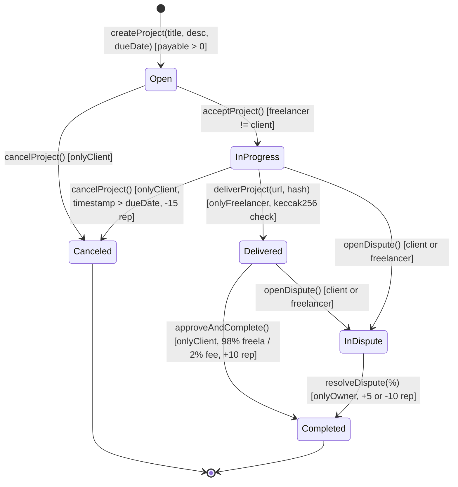

# 💼 Smart Freela — dApp de Escrow Descentralizado na Ethereum Sepolia

> Trabalho Prático da disciplina de **Oficina de Desenvolvimento de Sistemas 3** (Blockchain, Smart Contracts e dApps) — Curso de Sistemas de Informação (UEA-EST)  
> Docente: Prof. Fábio

---

## 1. Nome da dApp, Tema e Problema Resolvido

* **Nome da dApp:** **Smart Freela**
* **Tema:** Custódia Financeira (*Escrow*) Descentralizada para Contratação de Serviços Freelance
* **Problema Resolvido:**
  Plataformas tradicionais centralizadas de contratação freelance cobram taxas elevadas (frequentemente entre 10% e 20%), impõem prazos longos de liberação financeira e operam sistemas de mediação unilaterais. Por outro lado, acordos diretos sem intermediação expõem contratantes ao risco de não entrega e profissionais autônomos ao risco de inadimplência (*calote*).

O **Smart Freela** resolve esse problema utilizando a rede **Ethereum Sepolia** para automatizar a custódia e a liquidação dos pagamentos:
1. **Garantia Matemática de Fundos (Escrow):** O cliente cria a demanda com título, descrição e prazo limite (`dueDate`), depositando o valor em ETH diretamente no contrato inteligente (`createProject`), onde o saldo fica retido até a conclusão ou resolução.
2. **Execução Segura para o Freelancer:** O freelancer aceita o serviço (`acceptProject`) sabendo previamente que os fundos estão bloqueados on-chain.
3. **Entrega Transparente e Criptograficamente Auditável:** Ao concluir o serviço, o freelancer submete a URL do entregável (`deliveryUrl`) junto ao seu hash `bytes32` Keccak-256 (`deliverProject`). O contrato valida on-chain a integridade (`keccak256(bytes(deliveryUrl)) == deliveryHash`), garantindo que o cliente possa acessar o link para auditar o projeto com prova imutável de autoria.
4. **Liquidação Automatizada e Reputação On-Chain:** Ao aprovar (`approveAndComplete`), o contrato transfere **98%** do valor ao freelancer, retém **2%** como taxa de manutenção da plataforma e bonifica o profissional com **+10 pontos** de reputação (`int256`).
5. **Proteção de Prazo (`dueDate`), Cancelamento e Mediação de Disputas:** Projetos ainda abertos podem ser cancelados pelo cliente com reembolso de 100% (`cancelProject`). Caso o projeto esteja em andamento e o freelancer estoure o prazo limite (`block.timestamp > dueDate`), o cliente também pode cancelar unilateralmente por atraso (reembolso de 100% e penalidade de **-15 pontos** na reputação do freelancer). Projetos em andamento ou entregues permitem abertura de disputa (`openDispute`), mediada pelo administrador (`resolveDispute`) com divisão percentual configurável.



---

## 2. Integrantes e Papel de Cada Um

| Integrante | RA | Papel na Equipe |
|---|---|---|
| **Pedro Yutaro** | 2315310020 | Ideação da solução, Correções de fluxos e Deploy na Sepolia |
| **João Castro** | 2315310009 | Contrato Inteligente, Frontend e Deploy na Vercel |
| **Lucas Carvalho** | 2315310012 | Documentação, Diagramação e Assets |
| **Renato Barbosa** | 2315310021 | Estilização do Front, Vídeo de Demonstração e Slides |

---

## 3. Dados do Deploy na Sepolia, URL da Vercel e Vídeo

* **Contrato Inteligente:** `SmartFreela` ([contracts/SmartFreela.sol](contracts/SmartFreela.sol))
* **Rede:** Ethereum Sepolia Testnet (`Chain ID: 11155111` / `0xaa36a7`)
* **Endereço do Contrato:** `0x8eABC60d6C8DEeD4D9cf148522Cc9cbd45e76E8e` *(atualize caso tenha feito novo deploy da Opção A)*
* **Carteira Criadora (`owner` / Contract Creator):** `0xC1F78...F63D5` *(insira o endereço completo da carteira PedroYutaroUEA)*
* **Link no Sepolia Etherscan:** [https://sepolia.etherscan.io/address/0x8eABC60d6C8DEeD4D9cf148522Cc9cbd45e76E8e](https://sepolia.etherscan.io/address/0x8eABC60d6C8DEeD4D9cf148522Cc9cbd45e76E8e)
* **URL da dApp na Vercel:** [https://smart-freela-test-zcep.vercel.app/frontend/](https://smart-freela-test-zcep.vercel.app/frontend/)

---

## 4. Descrição das Funções do Contrato (`SmartFreela.sol`)

Além dos *getters* automáticos de variáveis públicas (`owner`, `PLATFORM_FEE_PERCENTAGE`, `DEFAULT_INITIAL_REPUTATION`, `totalProjects`, `accumulatedFees`, `isActive`, `projects`, `reputationDelta`, `participatedProjects`), o contrato implementa **13 funções externas/públicas**, **1 construtor** e **2 funções auxiliares (`internal` e `private`)**:

| Função / Assinatura | Visibilidade / Mutabilidade | Quem pode chamar | O que faz | Eventos emitidos | Erros possíveis |
|---|---|---|---|---|---|
| `constructor()` | `constructor` | Conta que realiza o deploy | Define `owner = msg.sender` (`immutable`). | — | — |
| `createProject(string title, string description, uint256 dueDate)` | `external payable` | Qualquer conta (Cliente) | Verifica se o contrato está ativo (`isActive`), valida `msg.value > 0`, textos e `dueDate > block.timestamp`. Registra `Project` com status `Open` e retém o ETH em custódia. | `ProjectCreated(id, client, amount, dueDate)` | `ContractPaused`, `InvalidAmount`, `InvalidData` |
| `getProject(uint256 id)` | `external view` | Qualquer conta / Frontend | Retorna a `struct Project` completa para o `id` informado. | — | `ProjectNotFound` |
| `acceptProject(uint256 id)` | `external` | Qualquer conta exceto o cliente do projeto | Valida `inStatus(id, Open)`, vincula `msg.sender` como `freelancer`, marca `participatedProjects` e muda status para `InProgress`. | `ProjectAccepted(id, freelancer)` | `ProjectNotFound`, `IncorrectStatus`, `AccessDenied` |
| `deliverProject(uint256 id, string deliveryUrl, bytes32 deliveryHash)` | `external` | Apenas o `freelancer` do projeto | Valida `inStatus(id, InProgress)` e `onlyFreelancer(id)`, exige `keccak256(bytes(deliveryUrl)) == deliveryHash`, grava URL e hash e muda status para `Delivered`. | `ProjectDelivered(id, deliveryHash, deliveryUrl)` | `ProjectNotFound`, `IncorrectStatus`, `AccessDenied`, `InvalidData` |
| `approveAndComplete(uint256 id)` | `external` | Apenas o `client` do projeto | Valida `inStatus(id, Delivered)` e `onlyClient(id)`. Muda status para `Completed`, soma `+10` em `reputationDelta`, acumula taxa (2%) e transfere 98% ao freelancer (padrão *CEI*). | `ProjectCompleted(id, freelancer, netValue)` | `ProjectNotFound`, `IncorrectStatus`, `AccessDenied`, `PaymentFailed` |
| `cancelProject(uint256 id)` | `external` | Apenas o `client` do projeto | Cancela e reembolsa 100% ao cliente se `Open`, ou se `InProgress` com prazo expirado (`block.timestamp > dueDate`, aplicando `-15` na reputação do freelancer). | `ProjectCanceled(id, client)` | `ProjectNotFound`, `AccessDenied`, `DeadlineNotExpired`, `IncorrectStatus`, `PaymentFailed` |
| `openDispute(uint256 id)` | `external` | `client` ou `freelancer` do projeto | Exige projeto existente em `InProgress` ou `Delivered` chamado por uma das partes; muda status para `InDispute`. | `DisputeOpened(id, requester)` | `ProjectNotFound`, `AccessDenied`, `IncorrectStatus` |
| `resolveDispute(uint256 id, uint256 freelancerPercentage)` | `external` | Apenas o `owner` (`onlyOwner`) | Valida `inStatus(id, InDispute)` e `freelancerPercentage <= 100`. Ajusta reputação (`+5` ou `-10`), finaliza o projeto e divide os fundos entre freelancer e cliente. | `DisputeResolved(id, freelancerAmount, clientAmount)` | `AccessDenied`, `ProjectNotFound`, `IncorrectStatus`, `InvalidPercentage`, `PaymentFailed` |
| `withdrawFees()` | `external` | Apenas o `owner` (`onlyOwner`) | Zera `accumulatedFees` (CEI) e transfere o saldo acumulado de taxas para `owner`. | `FeesWithdrawn(owner, amount)` | `AccessDenied`, `InvalidAmount`, `PaymentFailed` |
| `toggleContractActive()` | `external` | Apenas o `owner` (`onlyOwner`) | Alterna o estado booleano `isActive` (*Circuit Breaker*) para pausar/reativar novas publicações. | `ContractStatusToggled(isActive)` | `AccessDenied` |
| `getUserReputation(address user)` | `external view` | Qualquer conta / Frontend | Retorna a reputação calculada com sinal (`DEFAULT_INITIAL_REPUTATION + reputationDelta[user]`). | — | — |
| `calculateNetValue(uint256 grossAmount)` | `public pure` | Qualquer conta / Contrato | Simula o valor líquido que o freelancer receberá após a dedução da taxa de 2%. | — | — |
| `getUserProjects(address user, uint256 startIndex, uint256 limit)` | `external view` | Qualquer conta / Frontend | Retorna os IDs dos projetos em que `user` participou dentro da janela paginada (`limit` entre 1 e 50). | — | Reversão por `require` se `limit == 0` ou `limit > 50` |
| `_processPayment(address payable recipient, uint256 amount)` | `internal` | Apenas funções internas | Encapsula a transferência segura de ETH via `.call{value: amount}("")`. | — | `PaymentFailed` |
| `_calculateFee(uint256 amount)` | `private pure` | Apenas funções internas | Calcula `(amount * PLATFORM_FEE_PERCENTAGE) / 100`. | — | — |

---

## 5. Tabela de Mapeamento dos 7 Grupos de Recursos Obrigatórios

| # | Grupo de Recursos | Como foi implementado e Justificativa no Tema |
|---|---|---|
| **1** | **TiposDeDados** | • `uint256`: valores em wei (`amount`, `accumulatedFees`), IDs e timestamps (`createdAt`, `dueDate`, `completedAt`).<br>• `int256`: score de reputação com suporte a variações positivas e negativas (`DEFAULT_INITIAL_REPUTATION = 100`, `reputationDelta`).<br>• `bool`: circuit breaker operacional (`isActive`) e participação em projetos.<br>• `address` e `address payable`: carteiras `owner`, `client` e `freelancer`.<br>• `string`: `title`, `description` e `deliveryUrl` (link para auditoria).<br>• `bytes32`: `deliveryHash` validado via `keccak256(bytes(deliveryUrl))`.<br>• `constant` e `immutable`: `PLATFORM_FEE_PERCENTAGE`, `DEFAULT_INITIAL_REPUTATION` e `owner`. |
| **2** | **Funcoes** | • `constructor`: define `owner`.<br>• `external payable`: `createProject()` recebe o depósito do escrow.<br>• `external`: `acceptProject`, `deliverProject`, `approveAndComplete`, `cancelProject`, `openDispute`, `resolveDispute`, `withdrawFees`, `toggleContractActive`.<br>• `external view`: `getProject()`, `getUserReputation()` e `getUserProjects()`.<br>• `public pure`: `calculateNetValue()`.<br>• `internal`: `_processPayment()`.<br>• `private pure`: `_calculateFee()`. |
| **3** | **EstruturasDeControle** | • `require`: validação de paginação (`require(limit > 0 && limit <= 50, ...)`).<br>• `if / else if / else`: verificação de cancelamento normal vs. cancelamento por atraso de `dueDate` em `cancelProject`, bonificação/penalização condicional em `resolveDispute` e validações com `revert`.<br>• Laço `for` com limite controlado: paginação limitada a 50 registros em `getUserProjects`. |
| **4** | **ArraysEMappings** | • Array dinâmico: `uint256[] private _allIds`.<br>• Mappings simples: `mapping(uint256 => Project) public projects` e `mapping(address => int256) public reputationDelta`.<br>• Mapping aninhado: `mapping(address => mapping(uint256 => bool)) public participatedProjects`. |
| **5** | **StructsEEnums** | • `enum ProjectStatus`: 6 estados (`Open`, `InProgress`, `Delivered`, `Completed`, `Canceled`, `InDispute`).<br>• `struct Project`: 12 campos (`id`, `client`, `freelancer`, `amount`, `title`, `description`, `deliveryUrl`, `deliveryHash`, `status`, `createdAt`, `dueDate`, `completedAt`). |
| **6** | **Modificadores** | • Sem parâmetro: `onlyOwner()`.<br>• Com parâmetros: `inStatus(uint256 id, ProjectStatus expected)`, `onlyClient(uint256 id)` e `onlyFreelancer(uint256 id)`. |
| **7** | **EventosEErros** | • 9 eventos (`indexed`): `ProjectCreated`, `ProjectAccepted`, `ProjectDelivered`, `ProjectCompleted`, `ProjectCanceled`, `DisputeOpened`, `DisputeResolved`, `FeesWithdrawn`, `ContractStatusToggled`.<br>• 9 erros customizados: `InvalidAmount`, `InvalidData`, `AccessDenied`, `IncorrectStatus`, `PaymentFailed`, `InvalidPercentage`, `ProjectNotFound`, `DeadlineNotExpired`, `ContractPaused`. |

---

## 6. Estrutura do Repositório

```text
smart-freela/
├── contracts/
│   └── smart-freela.sol              # Contrato inteligente Solidity ^0.8.24 (7 grupos marcados + NatSpec)
├── frontend/
│   ├── index.html                    # Estrutura HTML5 semântica + Web3.js 4.16.0 via CDN
│   ├── styles.css                    # Identidade visual e responsividade (corresponde ao style.css do guia)
│   ├── app.js                        # Integração MetaMask, .call(), .send(), eventos e tratamento de erros
│   └── config.js                     # Endereço na Sepolia e ABI do contrato (corresponde ao contrato.js do guia)
├── docs/
│   ├── arquitetura.md                # Arquitetura técnica, matriz de permissões, diagramas e rastreabilidade SDD
│   └── prints/                       # Capturas do Etherscan, MetaMask e Frontend (Remix a adicionar)
│       ├── etherscan-contrato-1.png
│       ├── etherscan-contrato-2.png
│       ├── frontend-1.png
│       ├── frontend-2.png
│       └── metamask.png
├── test/
│   ├── baseline.test.js              # Verificação básica do ambiente Hardhat
│   └── SmartFreela.test.js           # Suíte de testes unitários do contrato (fluxo completo e reversões)
├── index.html                        # Redirecionamento na raiz para /frontend/
├── vercel.json                       # Rewrites para publicação estática na Vercel
├── hardhat.config.js                 # Configuração local de compilação e testes (Solidity 0.8.24)
└── README.md                         # Documentação principal do trabalho
```

---

## 7. URL na Vercel, Configuração da MetaMask na Sepolia e Execução Local

### 7.1 Acesso Online (Vercel)
* Acesse diretamente a dApp publicada: [https://smart-freela-test-zcep.vercel.app/frontend/](https://smart-freela-test-zcep.vercel.app/frontend/)

### 7.2 Como Configurar a MetaMask na Rede Sepolia
1. Instale a extensão **MetaMask** no navegador e crie ou importe suas carteiras de teste (**nunca use carteiras com fundos reais**).
2. Abra a MetaMask → clique no seletor de redes (canto superior esquerdo) → ative **"Mostrar redes de teste"** (*Show test networks*) e selecione **Sepolia**.
   * Caso a rede não apareça ou você conecte estando na Mainnet, o próprio frontend do Smart Freela solicita automaticamente a troca via `wallet_switchEthereumChain` (e o cadastro via `wallet_addEthereumChain`, se necessário, usando Chain ID `11155111` / `0xaa36a7`).
3. Obtenha **SepoliaETH** gratuito em faucets públicos (ex.: Google Cloud Web3 Faucet, Alchemy Sepolia Faucet ou QuickNode Sepolia Faucet) informando os endereços de teste.
4. Para testar todos os papéis completos, recomenda-se ter ao menos **2 contas com SepoliaETH** (Conta A = Cliente, Conta B = Freelancer). O **Painel do Administrador** aparece automaticamente quando conectado com a carteira proprietária (`0xf834Bc7C9272b1f6Cdd31Fb52E782Ad1447DFC24`).

### 7.3 Executar o Frontend Localmente
O frontend é estático (HTML5, CSS3 e JS vanilla com Web3.js `4.16.0` via CDN) e não requer build.

**Opção 1 — Python (recomendado):**
```bash
cd frontend
python -m http.server 5500
```
Acesse `http://localhost:5500`.

**Opção 2 — Node.js:**
```bash
npx serve frontend -p 5500
```
Acesse `http://localhost:5500`.

### 7.4 Testes Unitários Locais do Contrato (Hardhat)
Os arquivos de teste do contrato estão em [test/SmartFreela.test.js](test/SmartFreela.test.js) e [test/baseline.test.js](test/baseline.test.js):
```bash
npm install
npm test
```

---

## 8. Roteiro de Teste (Passo a Passo para o Avaliador)

1. **Conectar carteira (Conta 1 — Cliente):** Conecte a MetaMask na Sepolia. Verifique no cabeçalho o endereço, o saldo em ETH e o badge `⭐ Reputação: 100 pts`.
2. **Criar projeto com Prazo (`dueDate`) e ETH (`createProject`):** Preencha Título, Descrição, selecione uma data futura no campo **Prazo de Entrega (Due Date)** e informe o valor em ETH. Confirme na MetaMask.
3. **Aceitar projeto (Conta 2 — Freelancer, `acceptProject`):** Troque para a Conta 2 na MetaMask e clique em **"🤝 Aceitar Projeto"**. O status mudará para `Em Andamento`.
4. **Submeter entrega com URL + Hash `bytes32` (`deliverProject`):** Com a Conta 2, clique em **"🚀 Submeter Entrega"**, informe a URL do repositório/deploy e observe o hash Keccak-256 gerado automaticamente. Confirme a transação. O card passará a exibir o **Link da Entrega clicável** para auditoria do cliente junto ao comprovante `bytes32`.
5. **Auditar, aprovar e liberar pagamento (`approveAndComplete`):** Volte para a Conta 1, clique no link da entrega para auditar o trabalho e clique em **"✅ Aprovar & Liberar Pagamento"**. O freelancer receberá 98% do valor e sua reputação subirá para `110 pts` (+10).
6. **Testar Cancelamento e Governança (`cancelProject`, `resolveDispute`, `withdrawFees`, `toggleContractActive`):**
   * Crie um projeto `Aberto` e cancele imediatamente para receber 100% de reembolso.
   * Em um projeto em disputa, conecte com a carteira `owner` para visualizar o **Painel do Administrador**, resolver a disputa, sacar as taxas acumuladas (2%) ou testar o botão de pausar novas criações (*Circuit Breaker*).

---

## 9. Decisões de Arquitetura, Segurança e Dificuldades Contornadas

1. **Separação On-Chain vs. Off-Chain:** Apenas valores em wei, endereços, estado e o hash `bytes32` da entrega são gravados na blockchain, reduzindo custos de gas.
2. **Proteção contra Reentrância (Checks-Effects-Interactions):** Em `aprovarEFinalizar`, `cancelarProjeto`, `resolverDisputa` e `sacarTaxas`, todas as alterações de estado ocorrem antes das chamadas `.call{value: ...}("")`.
3. **Custom Errors para Economia de Gas:** Substituição de strings longas em `require` por `error ...` + `revert ...`.
4. **Dificuldades Contornadas durante o Desenvolvimento:**
   * **Decodificação de erros na Web3.js 4.x:** Implementada a função `tratarErro()` em [frontend/app.js](frontend/app.js#L809-L832) para traduzir erros `4001`, `-32002`, falta de saldo e os erros customizados do contrato para português claro.
   * **Troca automática para Sepolia:** Implementado `wallet_switchEthereumChain` com fallback para `wallet_addEthereumChain` caso a Sepolia ainda não esteja habilitada.
   * **Geração de `bytes32` na interface:** O modal de entrega utiliza `web3.utils.sha3()` para converter links/textos em hash Keccak-256 de 32 bytes antes do envio.

---

## 10. Limitações Conhecidas e Melhorias Futuras

### Limitações Conhecidas
* **Mediação centralizada no `owner`:** Caso uma disputa seja aberta antes do vencimento do prazo, a decisão da divisão percentual depende da carteira implantadora (`owner`).
* **Listagem sequencial no frontend:** O mural principal consulta de `1` até `totalProjects` via `getProject(i)`; em cenários de alto volume, a interface deve priorizar a função paginada `getUserProjects(user, startIndex, limit)`.
* **Verificação de conteúdo off-chain:** O contrato valida matematicamente que o `deliveryHash` corresponde à `deliveryUrl` informada, mas a verificação qualitativa do código/site no link continua dependendo da auditoria visual do cliente ou mediador.

### Melhorias Futuras
* Substituir o `owner` único por **multisig** ou **quórum de árbitros descentralizados** (Kleros / DAO).
* Integrar upload direto de arquivos para o **IPFS** via interface web.
* Suportar pagamentos em **stablecoins (ERC-20, como USDC)** além de ETH nativo.

---

## 11. Declaração de Uso de Ferramentas de IA

De forma transparente, a equipe utilizou ferramentas de Inteligência Artificial como apoio ao desenvolvimento nas seguintes etapas:
* **Google Gemini:** Auxílio no levantamento e comparação das 3 propostas iniciais de dApp, elaboração da especificação inicial orientadora (SDD) e validação das regras de negócio.
* **Antigravity (com metodologia Conductor / specs em `conductor/`):** Apoio na estruturação dos planos de implementação, revisão do código Solidity com os 7 grupos de recursos e NatSpec, construção da suíte de testes Hardhat, integração do frontend Web3.js 4.x e organização da documentação técnica do projeto.

Toda a lógica final do contrato, os testes, o deploy na Sepolia via Remix/MetaMask, a publicação na Vercel e a validação funcional end-to-end foram revisados, executados e testados pela equipe.

---

## 12. Documentação Complementar

* [📐 Arquitetura Técnica, Diagramas e Rastreabilidade SDD](docs/arquitetura.md)
* [📸 Evidências Visuais (Etherscan, MetaMask e Frontend)](docs/prints/)