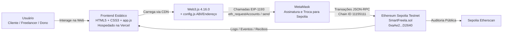
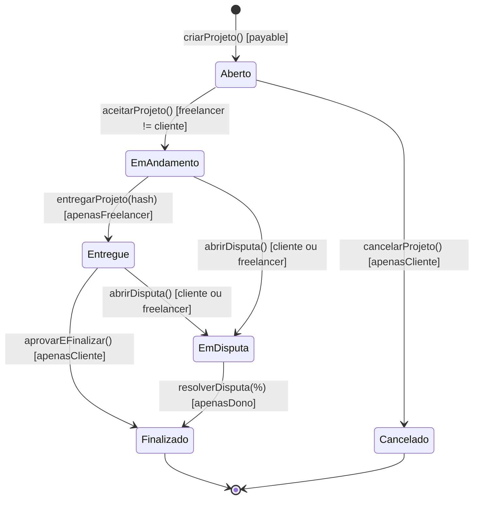
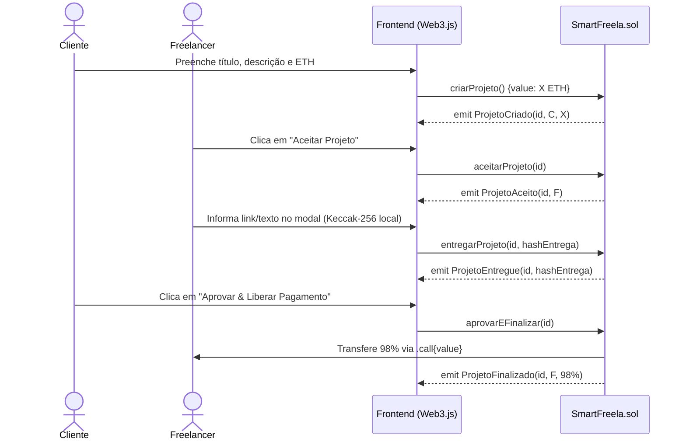
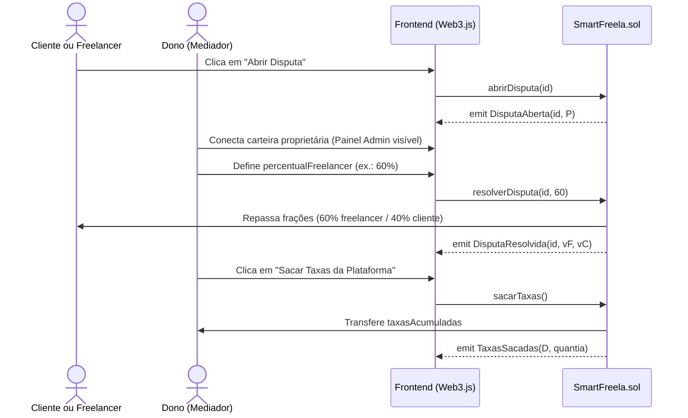

# Arquitetura Técnica e Especificação Consolidada — Smart Freela

Este documento consolida a arquitetura da dApp **Smart Freela**, os fluxos de interação entre frontend, MetaMask e contrato inteligente na Ethereum Sepolia, a matriz de controle de acesso, os padrões de segurança adotados e a rastreabilidade entre a especificação inicial (SDD) e a implementação final.

---

## 1. Visão Geral e Justificativa do Uso de Blockchain

Em contratações freelance tradicionais, há dois cenários problemáticos:
1. **Sem intermediário:** O cliente teme pagar adiantado e não receber; o freelancer teme trabalhar e não ser pago.
2. **Com intermediário Web2:** Plataformas centralizadas cobram taxas de 10% a 20%, retêm o pagamento por dias/semanas e decidem disputas de forma opaca.

A adoção de um contrato inteligente (*escrow*) na Ethereum resolve esse problema porque:
* **Custódia Programática e Imutável:** As regras de bloqueio e liberação de ETH são públicas e verificáveis no código do contrato (`SmartFreela.sol`).
* **Liquidação Direta P2P:** Ao aprovar a entrega, 98% do valor são transferidos na mesma transação ao freelancer (com apenas 2% retidos como taxa da plataforma).
* **Auditabilidade de Entregas e Eventos:** O hash `bytes32` do entregável e todos os marcos do projeto ficam registrados em eventos indexados na blockchain.

---

## 2. Arquitetura em Camadas

### Componentes Principais
* **Camada de Apresentação (`frontend/index.html`, `frontend/styles.css`):** Interface responsiva sem frameworks externos, com painel de rede, formulário de criação de projeto, mural filtrável (`Todos`, `Abertos`, `Meus Projetos`), feed de eventos em tempo real, modais de entrega/disputa e painel administrativo exclusivo para o `dono`.
* **Camada de Integração Web3 (`frontend/app.js`, `frontend/config.js`):**
  * Utiliza `Web3.js 4.16.0` via CDN jsDelivr.
  * Gerencia conexão, saldo (`web3.eth.getBalance`), validação e troca automática de rede (`wallet_switchEthereumChain` / `wallet_addEthereumChain`), ouvintes reativos (`accountsChanged`, `chainChanged`), leituras `.call()`, escritas `.send()`, histórico com `getPastEvents("allEvents")` e tratamento de erros em `tratarErro()`.
* **Camada On-Chain (`contracts/smart-freela.sol`):**
  * Compilado em Solidity `^0.8.24` (otimizador habilitado com `200` runs em `hardhat.config.js`).
  * Mantém o estado autoritativo dos projetos, custódia em ETH, regras de transição, eventos indexados e saldo acumulado de taxas.

---

## 3. Atores e Matriz de Permissões

| Ator | Identificação no Contrato | Ações Permitidas | Restrições Aplicadas |
|---|---|---|---|
| **Cliente** | `projetos[id].cliente` (`address payable`) | `criarProjeto()` (com ETH > 0), `aprovarEFinalizar(id)`, `cancelarProjeto(id)`, `abrirDisputa(id)` | Não pode aceitar o próprio projeto (`aceitarProjeto` reverte `AcessoNegado`); só cancela se `Aberto`; só aprova se `Entregue`. |
| **Freelancer** | `projetos[id].freelancer` (`address payable`) | `aceitarProjeto(id)`, `entregarProjeto(id, hashEntrega)`, `abrirDisputa(id)` | Só aceita se `Aberto` e não for o cliente; só entrega se `EmAndamento` e com `hashEntrega != bytes32(0)`. |
| **Dono / Mediador** | `dono` (`address immutable`) | `resolverDisputa(id, percentualFreelancer)`, `sacarTaxas()` | Restrito pelo modificador `apenasDono`; `resolverDisputa` exige status `EmDisputa` e `percentualFreelancer <= 100`. |
| **Qualquer Usuário** | Qualquer endereço / leitor | `obterProjeto(id)`, `listarProjetosDoUsuario(...)`, `calcularValorLiquido(...)` e getters públicos | Funções `view`/`pure` não alteram estado nem consomem gas em chamadas `.call()`. |

---

## 4. Máquina de Estados (`StatusProjeto`)

O ciclo de vida de cada projeto é controlado pelo `enum StatusProjeto` e protegido pelo modificador parametrizado `noStatus(uint256 id, StatusProjeto esperado)`:

### Tabela de Transições Válidas

| Estado Atual | Função Chamada | Novo Estado | Efeito Financeiro |
|---|---|---|---|
| *(Inexistente)* | `criarProjeto(titulo, descricao)` | `Aberto (0)` | Cliente envia `msg.value` em ETH, retido no contrato |
| `Aberto (0)` | `cancelarProjeto(id)` | `Cancelado (4)` | 100% do `valor` devolvido ao `cliente` |
| `Aberto (0)` | `aceitarProjeto(id)` | `EmAndamento (1)` | Nenhum; vincula `freelancer` ao projeto |
| `EmAndamento (1)` | `entregarProjeto(id, hash)` | `Entregue (2)` | Nenhum; grava `hashEntrega` (`bytes32`) |
| `Entregue (2)` | `aprovarEFinalizar(id)` | `Finalizado (3)` | 98% transferidos ao `freelancer`; 2% somados a `taxasAcumuladas` |
| `EmAndamento (1)` ou `Entregue (2)` | `abrirDisputa(id)` | `EmDisputa (5)` | Fundos permanecem bloqueados aguardando mediação |
| `EmDisputa (5)` | `resolverDisputa(id, %)` | `Finalizado (3)` | Divide `valor` entre `freelancer` (`%`) e `cliente` (`100 - %`) |

---

## 5. Diagramas de Sequência

### 5.1 Fluxo Principal (Criação → Entrega → Pagamento)

### 5.2 Fluxo de Disputa e Saque de Taxas

---

## 6. Segurança e Otimização de Gas

1. **Padrão *Checks-Effects-Interactions* (CEI):**
   * Em `aprovarEFinalizar`, `cancelarProjeto`, `resolverDisputa` e `sacarTaxas`, todas as validações (`Checks`) e atualizações de estado (`Effects`: `status`, `finalizadoEm`, `taxasAcumuladas = 0`) acontecem **antes** de qualquer transferência externa de ETH (`Interactions`), mitigando ataques de reentrância.
2. **Transferência Segura com `.call{value: quantia}("")`:**
   * Evita o limite fixo de 2.300 gas de `.transfer()` / `.send()`, verificando explicitamente o retorno booleano e revertendo com `FalhaNoPagamento()`.
3. **Custom Errors em vez de Strings:**
   * `ValorInvalido`, `DadosInvalidos`, `AcessoNegado`, `StatusIncorreto`, `FalhaNoPagamento`, `PercentualInvalido` e `ProjetoInexistente` reduzem o custo de bytecode no deploy e o gas consumido em reversões.
4. **Uso de `constant` e `immutable`:**
   * `TAXA_PLATAFORMA_PERCENTUAL` (`constant`) e `dono` (`immutable`) ficam embutidos no bytecode sem ocupar slots de `storage` mutável, economizando leituras `SLOAD`.
5. **Laço Limitado contra DoS / Out of Gas:**
   * `listarProjetosDoUsuario(usuario, inicio, limite)` impõe `require(limite > 0 && limite <= 50)`, garantindo que buscas em carteiras com muitos projetos não estourem o *block gas limit*.

---

## 7. Rastreabilidade: SDD Inicial vs. Implementação Final

Durante a evolução do projeto (registrada na especificação inicial SDD e em `conductor/tracks/`), o contrato foi refinado mantendo o tema e todos os 7 grupos de recursos obrigatórios:

| Aspecto | Esboço Inicial (Propostas / SDD) | Implementação Final (`contracts/smart-freela.sol`) | Justificativa da Evolução |
|---|---|---|---|
| **Idioma do Contrato** | Protótipo inicial em português, rascunho no Remix em inglês (`SmartFreela.sol`) | Padronizado integralmente em **português** com NatSpec completo | Alinhamento com o frontend e o roteiro de arguição da disciplina |
| **Vinculação do Freelancer** | Informado pelo cliente no momento de criar o serviço | Mercado aberto: cliente publica a demanda (`freelancer = address(0)`) e qualquer freelancer interessado aceita (`aceitarProjeto`) | Permite que a página funcione como um **Mural de Demandas** realista |
| **Entrega** | Apenas mudança para `Entregue` | Exige `bytes32 hashEntrega` (gerado via Keccak-256 no modal do frontend) | Justifica o uso funcional de `bytes32` exigido no Grupo 1 (`TiposDeDados`) |
| **Taxa da Plataforma** | Sem taxa explícita | `TAXA_PLATAFORMA_PERCENTUAL = 2` (`constant`), `taxasAcumuladas` e `sacarTaxas()` | Demonstra cálculo `private pure`, `public pure`, `constant` e painel exclusivo do `dono` |
| **Disputas** | Cancelamento unilateral pelo dono | Estado dedicado `EmDisputa`, `abrirDisputa()` pelas partes e `resolverDisputa(id, %)` pelo dono | Mediação transparente com divisão proporcional justa entre cliente e freelancer |
| **Prazo (`_deadline`)** | Timestamp futuro na criação | Removido na versão final em favor de `titulo`, `criadoEm` e `finalizadoEm` | Simplificou o fluxo de criação/testes no frontend mantendo rastreabilidade temporal |
